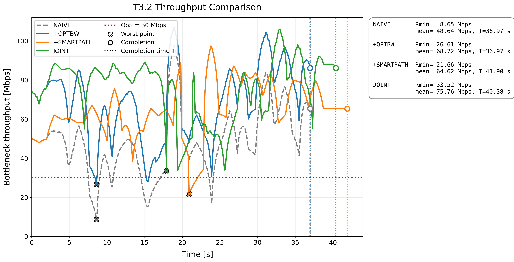
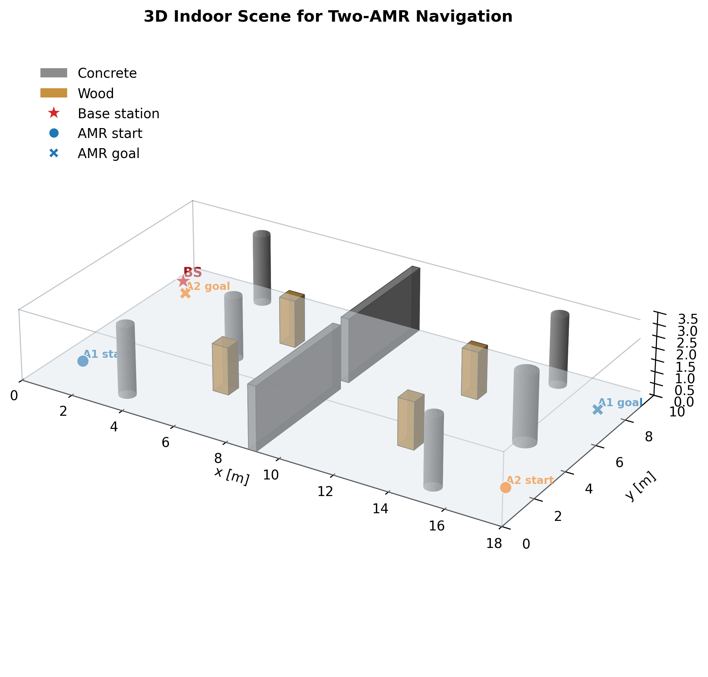

# Communication-Aware Path Planning and Resource Allocation for Warehouse AMRs

**Sujung Yun**

## Overview

Can two autonomous mobile robots (AMRs) maintain a minimum communication rate by adjusting both their routes and their share of radio resources?

This project investigates that question in a simulated indoor warehouse. It combines a Sionna RT channel map with candidate A* routes and time-varying subcarrier allocation. Four strategies are compared to examine the trade-off between communication quality and mission completion time.

## Main Result

**In the saved experiment, JOINT was the only one of the four strategies to meet the 30 Mbps requirement at every evaluated time.** It achieved a minimum rate of **33.53 Mbps** with a mission time of **40.38 s**, compared with **8.65 Mbps** and **36.97 s** for the shortest-path, equal-allocation baseline.

| Strategy | Route selection | Subcarrier allocation | Minimum rate (Mbps) | Mission time (s) | 30 Mbps QoS |
| --- | --- | --- | ---: | ---: | --- |
| NAIVE | Shortest paths | Equal split | 8.65 | 36.97 | Fail |
| +OPTBW | Shortest paths | Optimized split | 26.61 | 36.97 | Fail |
| +SMARTPATH | Candidate-pair search | Equal split | 21.66 | 41.90 | Fail |
| **JOINT** | **Candidate-pair search** | **Optimized split** | **33.53** | **40.38** | **Pass** |

The communication requirement was met at a cost of approximately **3.41 additional seconds** relative to the baseline. In this configuration, changing either allocation or route selection alone did not meet the target.

Here, minimum rate means the minimum over both AMRs and all evaluated times. Rates are Shannon-model estimates under a static channel, not measured packet throughput. Values are rounded from the saved outputs in [notebook 03](03_allocation_path_ablation.ipynb).



## Implementation

The repository includes:

- A warehouse radio scene and a grid-based, per-subcarrier channel fingerprint generated with Sionna RT.
- Candidate A* routes for two AMRs, synchronized trajectories, and SNR interpolation along each route.
- Equal and optimized contiguous subcarrier allocation, followed by QoS-constrained route-pair selection.
- Strategy comparisons, Pareto and QoS sensitivity analysis, trajectory animations, and a separate fading replay.

## Method

1. **Map the channel.** Compute the channel response and SNR on a 0.5 m receiver grid in an 18 m × 10 m warehouse.
2. **Generate routes.** Construct 30 candidate routes per AMR using the shortest path and seeded random-waypoint A* searches.
3. **Evaluate routes and allocations.** Evaluate all 900 route pairs. At each sampled time, optimized allocation tests the 63 nonempty contiguous splits of 64 subcarriers and selects the split that maximizes the lower AMR rate.
4. **Select a feasible pair.** Choose the shortest mission time among route pairs meeting the QoS requirement, breaking ties by higher minimum rate. If none is feasible, report the highest-minimum-rate pair as an infeasible fallback.



| Setting | Value |
| --- | --- |
| Carrier frequency / bandwidth | 5.8 GHz / 20 MHz |
| Antennas | One at the base station and one at each AMR (SISO) |
| Robot speed / evaluation interval | 0.5 m/s / 0.1 s, plus the exact mission endpoint |
| QoS target | 30 Mbps for each AMR at every evaluated time |
| Link asymmetry | AMR 2 has a configured −7 dB SNR offset |

## Scope and Limitations

- Route selection is restricted to the 900 candidate pairs; it does not establish a global optimum over all possible routes.
- QoS satisfaction applies to sampled times in the static-channel model. The separate fading replay examines robustness with fixed routes and allocations.
- The rate model uses SISO links, fixed power per active subcarrier, and simplified propagation. Interference and protocol overhead are omitted.
- Navigation uses a discrete occupancy grid. AMR-to-AMR collision avoidance and continuous robot-footprint clearance are outside the model.

## Reproducing the Results

The project uses Python 3.11; [requirements.txt](requirements.txt) pins `sionna-rt==2.0.1`. Install the dependencies in a suitable environment and launch Jupyter:

```bash
python -m pip install -r requirements.txt
jupyter lab
```

- **Analyze the included results:** run notebooks **03 → 04 → 05** using the saved NPZ files.
- **Regenerate the full experiment:** run **scene → 01 → 02 → 03 → 04 → 05**. A CUDA-enabled Mitsuba environment is recommended for ray-tracing runtime.

Regenerate the upstream results after changing geometry, materials, or radio settings; rerunning notebooks can overwrite generated files.

**Explore:** [Figures](results/figures/) · [Animations](results/animations/) · [Configuration](project_config.py) · [Allocation functions](simulator.py)
