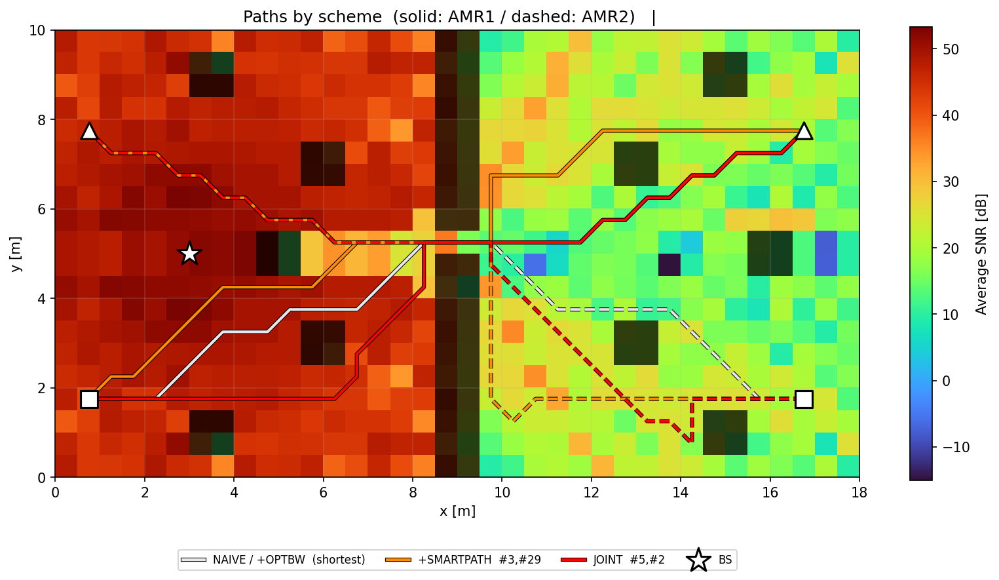
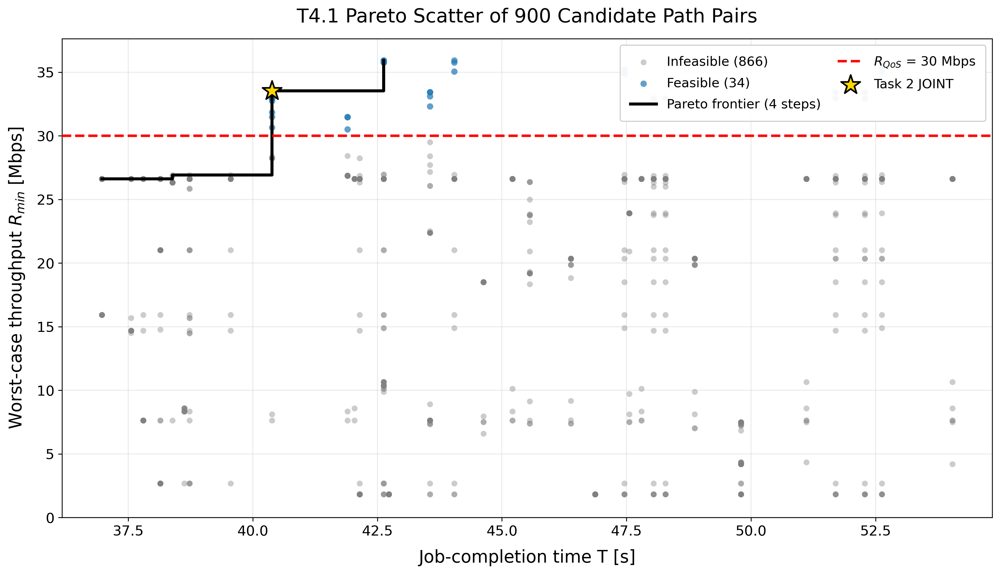
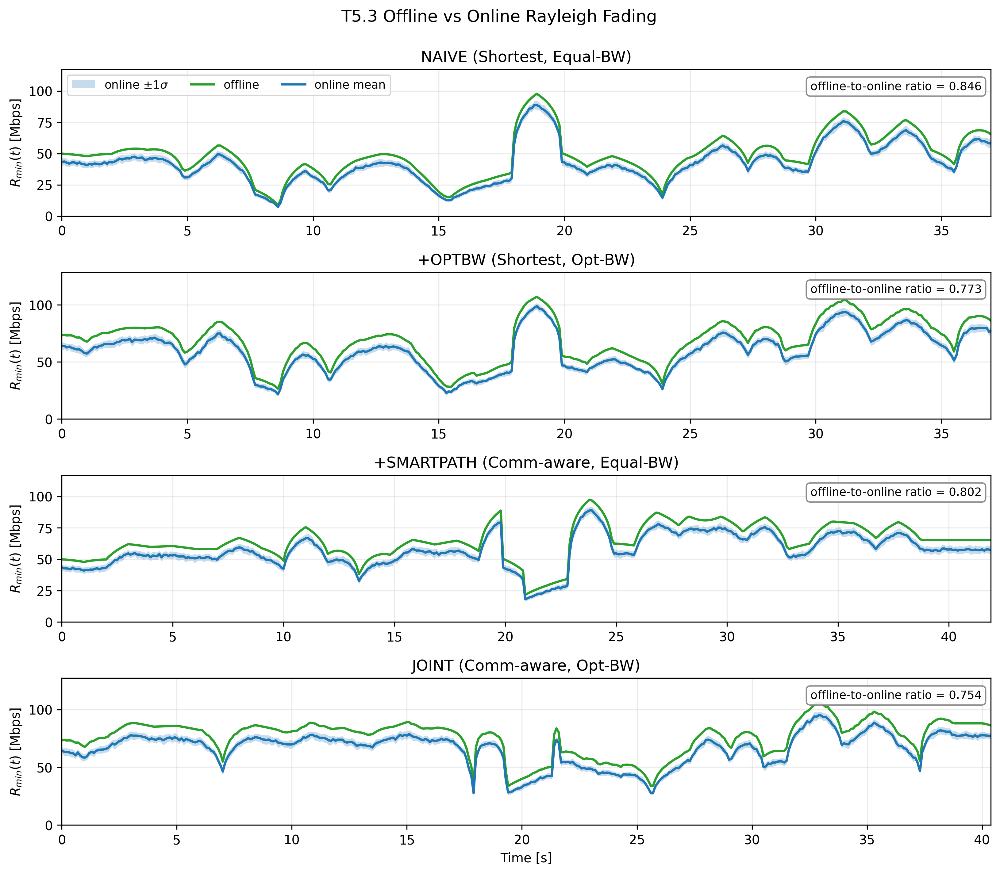

# Communication-Aware Radio Resource Allocation for Warehouse AMRs

An end-to-end study of how radio conditions can inform the motion planning of
autonomous mobile robots (AMRs) in an indoor warehouse. The project combines a
custom Sionna RT scene, channel fingerprinting, candidate-path search, and
subcarrier allocation for two simultaneously moving AMRs.

## Overview

Conventional shortest-path planning can guide a robot through locations with
poor wireless coverage. This repository evaluates a communication-aware
alternative: select AMR paths and divide radio resources jointly, while meeting
a minimum-rate quality-of-service (QoS) target.

The implementation is a reproducible simulation study rather than a deployed
warehouse controller. All geometry, physical-layer settings, mission settings,
and planning parameters are defined in
[project_config.py](project_config.py).

## Project at a glance

| Item | Experiment design |
| --- | --- |
| Environment | Custom 18 m × 10 m indoor warehouse with walls, pillars, cabinets, and a base station |
| Propagation model | Sionna RT ray tracing at 5.8 GHz |
| Radio resources | 20 MHz bandwidth split into 64 subcarriers |
| Channel representation | 0.5 m receiver grid (36 × 20 cells) with a per-subcarrier SNR fingerprint |
| AMR mission | Two AMRs travel between opposing warehouse corners at 0.5 m/s |
| Planning search | 30 feasible candidate paths per AMR; 900 path-pair evaluations |
| QoS target | Minimum instantaneous AMR rate of 30 Mbps |
| Link asymmetry | AMR 2 has a −7 dB link offset to create an unequal-channel scenario |

## End-to-end workflow

~~~text
Warehouse geometry
      ↓
Ray-traced channel fingerprint (SNR per grid cell and subcarrier)
      ↓
Candidate A* paths for two AMRs
      ↓
Path-pair evaluation + subcarrier allocation
      ↓
Pareto / QoS / fading robustness analysis
~~~

1. **Warehouse scene construction** builds PLY geometry and a Mitsuba/Sionna RT
   XML scene.
2. **Channel fingerprinting** traces propagation paths and evaluates a channel
   frequency response and SNR for each grid location.
3. **Path planning** produces collision-free candidate A* paths, converts them
   into synchronized trajectories, and interpolates the radio fingerprint along
   each route.
4. **Resource allocation** assigns the 64 subcarriers over time and evaluates
   the bottleneck AMR rate and mission duration.
5. **Analysis** compares strategies, constructs a QoS-constrained Pareto
   frontier, and replays the chosen paths under Rayleigh fading.

## Compared strategies

| Strategy | AMR route | Subcarrier allocation | Role in the comparison |
| --- | --- | --- | --- |
| **NAIVE** | Shortest path | Equal split | Mobility- and radio-unaware baseline |
| **+OPTBW** | Shortest path | Optimized split | Isolates the benefit of allocation |
| **+SMARTPATH** | Communication-aware path | Equal split | Isolates the benefit of route selection |
| **JOINT** | Communication-aware path | Optimized split | Joint planning and allocation strategy |

The primary performance views are mission time, instantaneous per-AMR rate,
bottleneck rate, feasible path pairs under the QoS target, and robustness to
online fading.

## Selected outputs

| Warehouse radio scene | Paths selected by each strategy |
| --- | --- |
|  |  |

| QoS-constrained Pareto frontier | Offline versus online fading replay |
| --- | --- |
|  |  |

Additional figures are in [results/figures/](results/figures), and baseline
and joint-strategy animations are in
[results/animations/](results/animations).

## Notebooks and execution order

Run the notebooks in the following order when regenerating the complete
pipeline.

| Step | Notebook | Purpose | Main output |
| --- | --- | --- | --- |
| 0. | [scene.ipynb](scene.ipynb) | Build the warehouse mesh and radio-scene XML | scene/ |
| 1. | [01_channel_fingerprint_map.ipynb](01_channel_fingerprint_map.ipynb) | Generate the ray-traced channel fingerprint map | results/data/fingerprint.npz |
| 2. | [02_multi_amr_path_planning.ipynb](02_multi_amr_path_planning.ipynb) | Evaluate paths and allocations for both AMRs | results/data/path_planning_results.npz |
| 3. | [03_allocation_path_ablation.ipynb](03_allocation_path_ablation.ipynb) | Compare allocation and route-planning contributions | 00_bw_share.png, 01_throughput.png, 10_ablation_bars.png |
| 4. | [04_pareto_qos_analysis.ipynb](04_pareto_qos_analysis.ipynb) | Analyze the Pareto frontier and QoS sweep | 11_pareto.png, 12_qos_sweep.png |
| 5. | [05_animation_robustness.ipynb](05_animation_robustness.ipynb) | Render trajectory animations and evaluate fading robustness | 14_naive_animation.mp4, 15_joint_animation.mp4, 13_offline_vs_online.png |

Steps 3–5 can be run immediately using the included NPZ results. To regenerate
the analysis inputs, run steps 0–2 first.

## Quick start

The project uses Python 3.11 and pins the ray-tracing package version in
[requirements.txt](requirements.txt). From the repository root:

~~~bash
python3.11 -m venv .venv
source .venv/bin/activate
python -m pip install --upgrade pip
python -m pip install -r requirements.txt
jupyter lab
~~~

Open the notebooks in the execution order above. A CUDA-enabled Mitsuba setup
is recommended for practical ray-tracing runtimes. The animation notebook uses
imageio-ffmpeg and falls back to GIF output if an FFmpeg writer is not
available.

## Repository layout

~~~text
.
├── project_config.py              # Shared physical-layer, AMR, and planning settings
├── project_radio_material.py      # Custom Mitsuba/Sionna RT material plugin
├── simulator.py                   # Rate and subcarrier-allocation helpers
├── scene.ipynb                    # 0. Warehouse scene construction
├── 01_channel_fingerprint_map.ipynb
├── 02_multi_amr_path_planning.ipynb
├── 03_allocation_path_ablation.ipynb
├── 04_pareto_qos_analysis.ipynb
├── 05_animation_robustness.ipynb
├── scene/                         # Generated XML scene and PLY meshes
└── results/
    ├── data/                      # Reproducible fingerprint and planning arrays
    ├── figures/                   # PNG figures shown in this README
    └── animations/                # MP4 trajectory animations
~~~

## Reproducibility notes

- **project_config.py** is the single source of truth for room geometry, PHY
  parameters, AMR start/goal positions, QoS, and candidate-path settings.
- **project_radio_material.py** contains the custom material registration used
  by the generated scene.
- Notebook cell outputs are intentionally cleared before commit; the versioned
  figures, animations, and NPZ files preserve the final experiment outputs.
- Rerunning scene generation, planning, or analysis notebooks can overwrite
  their corresponding generated assets in **scene/** and **results/**.
